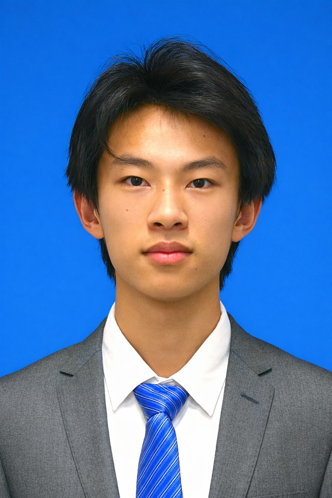



<section class="home-hero" id="top">
  

    <nav class="home-hero__quicklinks" aria-label="Profile quick links">
      <a href="#research">Research</a>
      <a href="/portfolio/">Projects</a>
      <a href="/publications/">Publications</a>
      <a href="/cv/">CV</a>
    </nav>
    <h1>Yanzhe (Justin) Zhao</h1>
    
Computational Neuroscience | Cognitive Neuroscience | Neuro-AI

    

      B.Eng. in Automation student at the School of Future Technology, Tianjin University. The School of Future Technology is Tianjin University's elite undergraduate college, and its Intelligent Machine Platform honors track admits students through Gaokao-based selection and internal university selection.
    

    

      After two years of shared training in mathematics, physics, and engineering fundamentals, I selected Automation as my major. I now study how neural and cognitive mechanisms can inform computational models of learning, prediction, and representation.
    

    

      My academic path started from robotics, control, and reinforcement learning. It is now centered on computational and cognitive neuroscience, with particular interest in world models, predictive processing, neural mechanisms of natural language acquisition, and embodied cognition.
    

    

      <a class="btn btn--primary" href="/cv/">View CV</a>
      <a class="btn btn--inverse" href="/portfolio/">Explore Projects</a>
    

  

  <aside class="home-hero__profile" aria-label="Academic profile summary">
    
    

      
<strong>8/100</strong>Overall rank

      
<strong>1/8</strong>Junior specialization rank

      
<strong>91.54</strong>Weighted score

      
<strong>3.85/4.0</strong>GPA

    

  </aside>
</section>

<section class="home-section research-band" id="research">
  

    Research Direction
    <h2>From embodied control to computational models of mind and brain.</h2>
  

  

    <article data-step="01">
      
Foundation

      <h3>Robotics and Control Foundation</h3>
      
Built a systems-level base through automatic control, signal processing, robot kinematics, embedded systems, numerical methods, and full-stack robot projects.

    </article>
    <article data-step="02">
      
Transition

      <h3>Learning and Decision Making</h3>
      
Used deep reinforcement learning for constrained navigation, connecting policy learning, spatial planning, and action under nonholonomic limits.

    </article>
    <article data-step="03">
      
Current focus

      <h3>Computational and Cognitive Neuroscience</h3>
      
Now focusing on neural computation, predictive processing, world models, cognitive maps, language learning, and Neuro-AI models that can be tested scientifically.

    </article>
  

</section>

<section class="home-section publication-band" id="publications">
  

    Publication
    <h2>Peer-reviewed work on deep reinforcement learning for constrained spatial navigation.</h2>
  

  <article class="publication-feature">
    
CSAI 2025 | ACM Proceedings | pp. 126-131

    <h3>Nonholonomic Narrow Dead-End Escape with Deep Reinforcement Learning</h3>
    
Denghan Xiong, <strong>Yanzhe Zhao</strong>, Yutong Chen, and Zichun Wang. Proceedings of the 2025 9th International Conference on Computer Science and Artificial Intelligence.

    

      <a href="https://doi.org/10.1145/3788149.3788204">ACM DOI</a>
      <a href="https://dblp.org/rec/conf/csai/XiongZCW25">DBLP</a>
      <a href="https://arxiv.org/abs/2511.22338">arXiv</a>
      <a href="/files/bib/nonholonomic_deadend_2025.bib">BibTeX</a>
    

  </article>
</section>

<section class="home-section" id="projects">
  

    

      Selected Projects
      <h2>Evidence of neuroscience readiness, applied ML, AI implementation, and engineering depth.</h2>
    

    <a href="/portfolio/">All projects</a>
  

  

    
      
    
  

</section>

<section class="home-section coursework-band" id="training">
  

    Coursework and Training
    <h2>Structured training across elite engineering, research practice, neuroscience, and machine learning.</h2>
  

  

    <article class="training-feature">
      
Elite undergraduate college

      <h3>School of Future Technology, Intelligent Machine Platform</h3>
      
The School of Future Technology is Tianjin University's elite undergraduate college. The Intelligent Machine Platform honors track admits students through Gaokao-based selection and internal university selection.

      
The first two years provide shared training in mathematics, physics, and engineering fundamentals. After sophomore-year major selection, I chose Automation.

      

        
<strong>8/100</strong>Overall rank

        
<strong>1/8</strong>Junior specialization rank

        
<strong>91.54</strong>Weighted score

        
<strong>3.85/4.0</strong>GPA

      

    </article>

    

      <article>
        <time>2026.07</time>
        

          <h3>Computational Neuroscience Online Summer School</h3>
          
Neuromatch Academy. Upcoming training in computational neuroscience, neural data analysis, dynamical systems, learning, decision making, and cognition.

        

      </article>
      <article>
        <time>2025.07-08</time>
        

          <h3>In-person Summer Research</h3>
          
NeoScholar and Imperial College London, supervised by Prof. Sen Wang. Developed and evaluated deep reinforcement learning methods for nonholonomic narrow dead-end escape, leading to the CSAI 2025 publication. Evaluation: A.

        

      </article>
      <article>
        <time>2025.03-06</time>
        

          <h3>Robot Perception, Localization and Navigation</h3>
          
NeoScholar and Imperial College London audit covering SLAM, localization, navigation, and implementation-oriented robotics methods.

        

      </article>
      <article>
        <time>2024.10-2025.01</time>
        

          <h3>Robotic Manipulation</h3>
          
NeoScholar and Imperial College London course with high score and CIEI certification; completed kinematics, dynamics, grasping, custom gripper design, and simulation assignments.

        

      </article>
      <article>
        <time>2024.07</time>
        

          <h3>Computing Applications in Science and Engineering</h3>
          
University of Bristol Summer School. Used Java and Go for scientific computing; built satellite-control simulation and Arduino/networked sensing projects.

        

      </article>
    

  

  

    

      Selected Coursework
      <h2>Course clusters supporting the current neuroscience and Neuro-AI direction.</h2>
    

    

      <article>
        <h3>Neuroscience and Machine Learning</h3>
        
Brain and Cognition; Intelligent Medical Signal Processing; Optimization-based Machine Learning; Deep Learning; Pattern Recognition and Brain-like Intelligence.

      </article>
      <article>
        <h3>Mathematics and Computation</h3>
        
Mathematical Analysis; Advanced Linear Algebra; Probability and Mathematical Statistics; Equation of Mathematics and Physics; Numerical Computational Method; Discrete Mathematics.

      </article>
      <article>
        <h3>Signals, Control, and Robotics</h3>
        
Signals and Systems; Automatic Control; Theory of Motor; Robot Kinematics and Dynamics; Computer Organization and Architecture; C++ Programming.

      </article>
      <article>
        <h3>Online Certificates and Study</h3>
        
MITx Introduction to Differential Equations; DelftX MECH1x Building Robots: Electrical Drives; DelftX MECH2x Building Robots: Sensors and Data Acquisition; University of Padova Foundations of Signals and Systems; Stanford Machine Learning, Deep Learning, and Convex Optimization tracks; UW Computational Neuroscience materials.

      </article>
    

  

</section>

<section class="home-section contact-band" id="contact">
  

    Contact
    <h2>Open to research conversations in computational neuroscience, cognitive neuroscience, and Neuro-AI.</h2>
  

  

    <a href="mailto:justinzhaoyz@outlook.com">justinzhaoyz@outlook.com</a>
    <a href="https://github.com/JustinZHAO-05">GitHub</a>
    <a href="https://orcid.org/0009-0003-5342-6611">ORCID</a>
  

</section>
