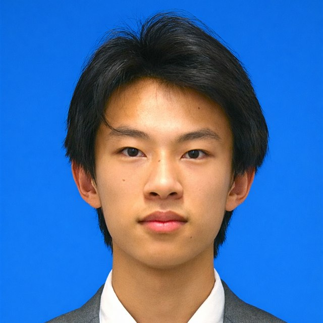

  <section class="cv-hero">
    
    

      <h2>Yanzhe (Justin) Zhao</h2>
      
Computational Neuroscience | Cognitive Neuroscience | Neuro-AI

      
B.Eng. in Automation, School of Future Technology, Tianjin University. Intelligent Machine Platform Honors Track.

      

        <a class="btn btn--primary" href="/files/Yanzhe_Zhao_CV.pdf">Download PDF CV</a>
        <a class="btn btn--inverse" href="mailto:justinzhaoyz@outlook.com">Email</a>
      

    

  </section>

  <section>
    <h2>Education</h2>
    
<strong>Tianjin University</strong>, School of Future Technology. B.Eng. in Automation, 2023-present.

    <ul>
      <li><strong>Overall:</strong> rank <strong>8/100</strong>; weighted score <strong>91.54</strong>; GPA <strong>3.85/4.0</strong>.</li>
      <li><strong>Junior specialization:</strong> rank <strong>1/8</strong>; weighted score <strong>96.55</strong>; GPA <strong>3.98/4.0</strong>.</li>
      <li>The School of Future Technology is Tianjin University's elite undergraduate college; the Intelligent Machine Platform honors track admits students through Gaokao-based selection and internal university selection.</li>
      <li>The first two years provide shared training in mathematics, physics, and engineering fundamentals. After sophomore-year major selection, I chose Automation.</li>
    </ul>
  </section>

  <section>
    <h2>Research Interests</h2>
    
Computational neuroscience, cognitive neuroscience, Neuro-AI, predictive processing, world models, natural language acquisition, cognitive maps, neural learning mechanisms, and embodied cognition.

  </section>

  <section>
    <h2>Publication</h2>
    
<strong>Denghan Xiong, Yanzhe Zhao, Yutong Chen, and Zichun Wang.</strong> Nonholonomic Narrow Dead-End Escape with Deep Reinforcement Learning. <em>Proceedings of the 2025 9th International Conference on Computer Science and Artificial Intelligence</em>, ACM, pp. 126-131. DOI: <a href="https://doi.org/10.1145/3788149.3788204">10.1145/3788149.3788204</a>.

  </section>

  <section>
    <h2>Selected Training</h2>
    <ul>
      <li><strong>Neuromatch Academy Computational Neuroscience</strong>, online summer school, July 2026.</li>
      <li><strong>Junior spring:</strong> Brain and Cognition; Intelligent Medical Signal Processing; Optimization-based Machine Learning; Deep Learning; Pattern Recognition and Brain-like Intelligence.</li>
      <li><strong>Junior fall:</strong> Equation of Mathematics and Physics; Theory of Motor; Numerical Computational Method.</li>
      <li><strong>Online certificates:</strong> MITx Introduction to Differential Equations, issued Dec. 24, 2025; DelftX MECH1x Building Robots: Electrical Drives, issued Dec. 16, 2025; DelftX MECH2x Building Robots: Sensors and Data Acquisition, issued Dec. 16, 2025.</li>
      <li><strong>Research training:</strong> Imperial College London / NeoScholar research with Prof. Sen Wang; University of Bristol CASE summer school; Padova Signals and Systems certificate.</li>
    </ul>
  </section>

  <section>
    <h2>Selected Projects</h2>
    
    <ul class="cv-project-list">
      
        <li><strong>{{ project.title }}.</strong> {{ project.summary }} <a href="{{ project.links.github }}">GitHub</a></li>
      
    </ul>
  </section>

  <section>
    <h2>Skills</h2>
    
<strong>Programming:</strong> Python, C++, MATLAB/Simulink, Verilog, Java. <strong>Scientific computing:</strong> NumPy, SciPy, Matplotlib, PyTorch-style workflows, Brian2. <strong>Robotics and systems:</strong> ROS2/ROS1, Gazebo, control, embedded development, SolidWorks, Linux, Docker, Git, LaTeX.

  </section>

